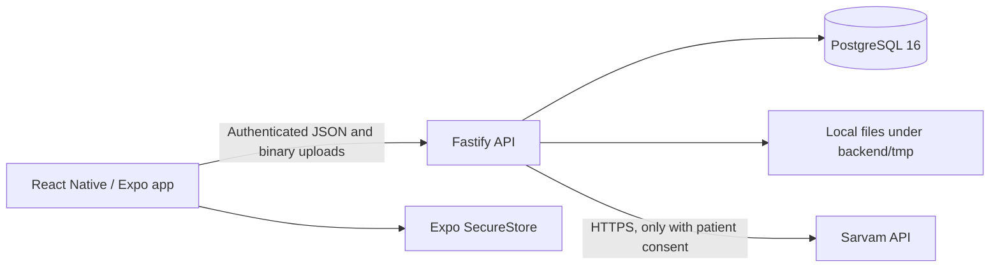

# Physio Note Finisher

An Android-first coding showcase for post-visit physiotherapy documentation. The repository contains a React Native/Expo mobile app, a Fastify API, PostgreSQL persistence through Prisma, local audio/file storage, and an optional Sarvam-powered transcription and note-generation pipeline.

The app supports:

- Clinician sign-in and password changes
- Patient, appointment, session and timeline workflows
- Manual, editable SOAP notes
- Voice recap upload, transcript review and AI-assisted draft generation
- Patient-friendly summaries and PDF/text export
- Encrypted device storage for offline drafts and queued changes

AI output is always an editable draft. Manual note entry remains available when Sarvam is unconfigured or unavailable.

## Demo

**40-second local walkthrough (synthetic data)**

https://github.com/user-attachments/assets/8a867cc8-cf78-4caf-9507-ec838af14bf4

The video uses only the repository's synthetic seeded data and demonstrates patient context, editable SOAP-note review, a finalized note with a patient-friendly summary, and export actions. It does not demonstrate a live AI/voice request, production deployment, or clinical compliance.

## Architecture



See [docs/architecture.md](docs/architecture.md) for the implemented flows and trust boundaries.

## Prerequisites

- Node.js 20 or newer
- npm 10 or newer
- Docker with Docker Compose
- Android Studio and an Android emulator, or a connected Android device
- A Sarvam API key for voice transcription and AI generation

## Local setup

```bash
npm ci
cp backend/.env.example backend/.env
cp mobile/.env.example mobile/.env
```

Replace the placeholder JWT secrets and `SARVAM_API_KEY` in `backend/.env`. Then start and seed PostgreSQL:

```bash
npm run local:setup
```

Start the backend in one terminal:

```bash
npm run dev
```

Start the Android app in another:

```bash
npm run android
```

The seeded local account is:

- Email: `clinician@example.com`
- Password: `password123`

All committed seed data is synthetic. Do not enter real patient or clinician data into this demonstration environment.

### Android networking

The default `mobile/.env.example` uses:

```env
EXPO_PUBLIC_API_BASE_URL=http://10.0.2.2:3000
```

`10.0.2.2` reaches the host computer from the standard Android emulator. For a USB-connected physical device, run `adb reverse tcp:3000 tcp:3000` and use `http://localhost:3000`.

## Sarvam configuration

Sarvam is the only external API integration:

```env
SARVAM_API_KEY=replace-with-your-sarvam-api-key
```

Without a configured key, AI routes return `503` with `sarvam_not_configured`; manual note entry remains usable. Voice and clinical text are sent to Sarvam only after an active patient AI-processing consent record is confirmed.

## Verification

```bash
npm run verify
npm audit
npm run doctor
```

`npm run verify` executes ESLint, TypeScript checking and the committed Vitest suites in all three workspaces. Test coverage and current limitations are documented in [docs/testing.md](docs/testing.md).

## Repository boundary

This public repository is a local coding demonstration. It deliberately excludes deployment pipelines, cloud infrastructure, release automation, app-store submission configuration, private runbooks and development history.

## License

Copyright © 2026. All rights reserved.

The source is published for portfolio review and local evaluation. It is not offered under an open-source license.
