# Physio Note Finisher

**Speak a 30-second recap after a physio visit. Get an editable SOAP note, a
plain-language summary for the patient, and a PDF, before the next patient walks in.**

An Android app and API for solo physiotherapists and small clinics, built end to end:
React Native + Expo, Fastify, PostgreSQL, a staged voice-to-note pipeline, and an
AWS deployment. This repo runs locally with **zero API keys**.

[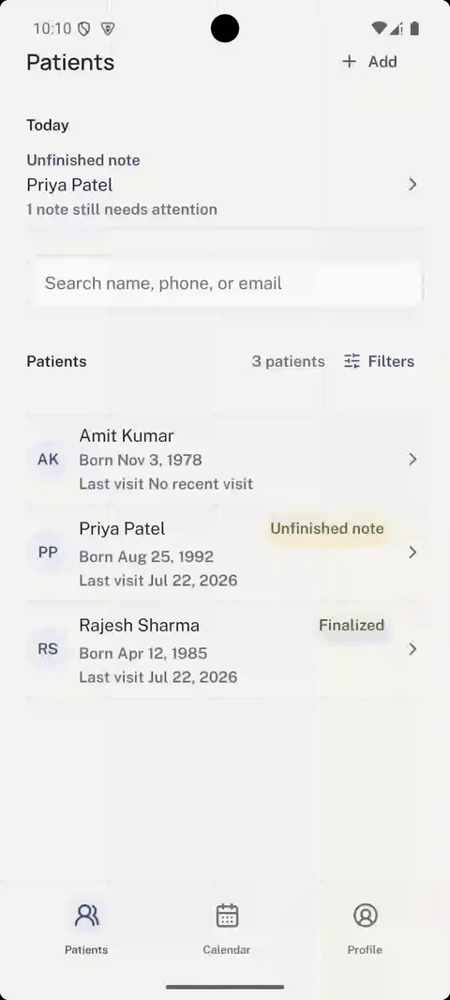](https://www.youtube.com/watch?v=t8U_YSuLnHM)

[Watch the 40-second demo](https://www.youtube.com/watch?v=t8U_YSuLnHM) ·
[Try the API in 2 minutes](docs/api-tour.md) ·
[Architecture](docs/architecture.md) ·
[How it was built](docs/engineering-process.md)

## Why

Physiotherapists in small practices see a patient every 30–45 minutes and write
their notes at night. The notes still have to be accurate, because they are the
clinical record. This app is built around three rules:

1. **The clinician owns the note.** AI output is always a draft, reviewed section
   by section before it can be finalized.
2. **AI never blocks finishing.** A full manual note path works with no AI and no
   network.
3. **Patient data is treated as clinical data.** Consent before any audio leaves
   the phone, clinic-scoped access everywhere, nothing sensitive in logs.

## The app

| | | |
| :---: | :---: | :---: |
| 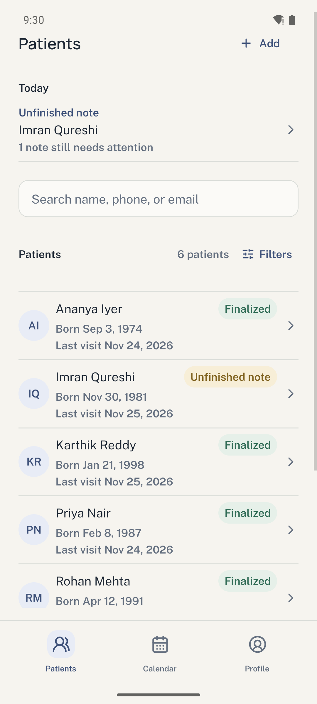 | 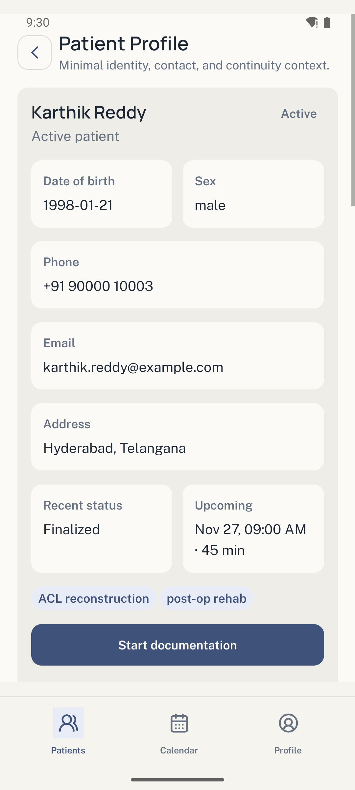 | 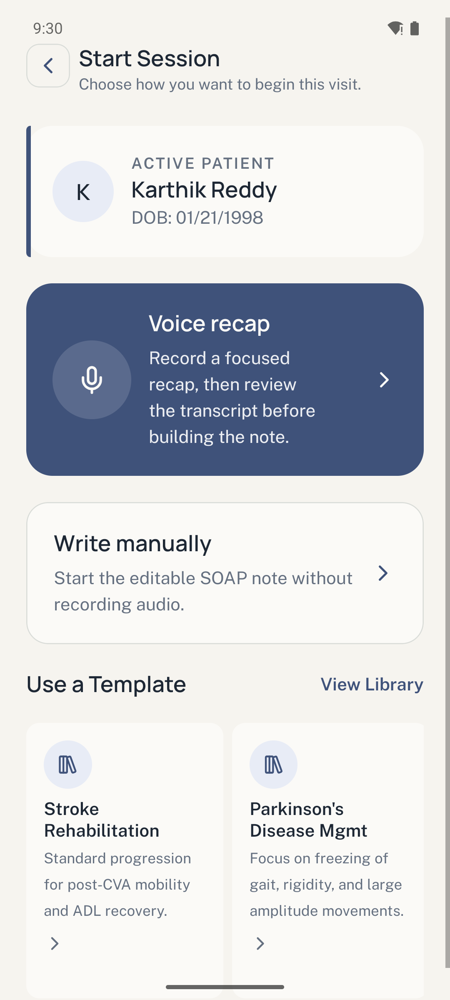 |
| Patients, with unfinished notes surfaced first | Profile and visit history | Voice recap or manual note |
| 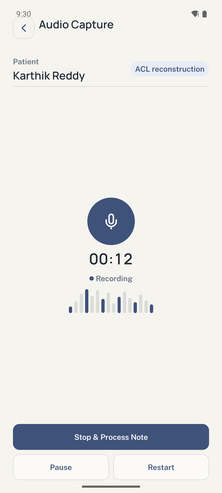 | 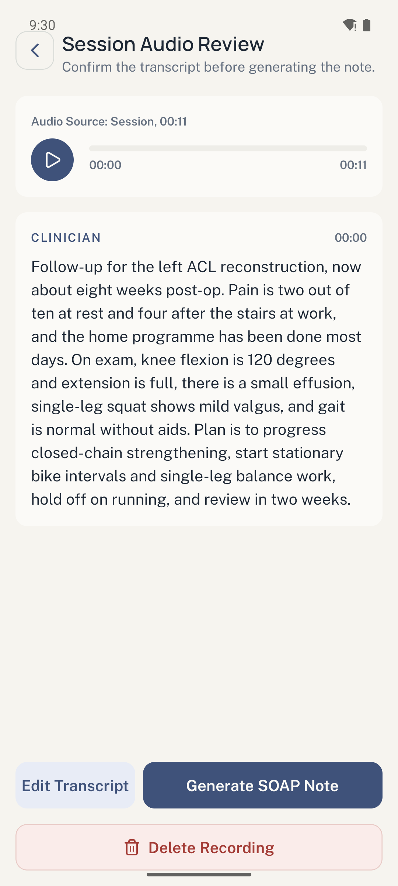 | 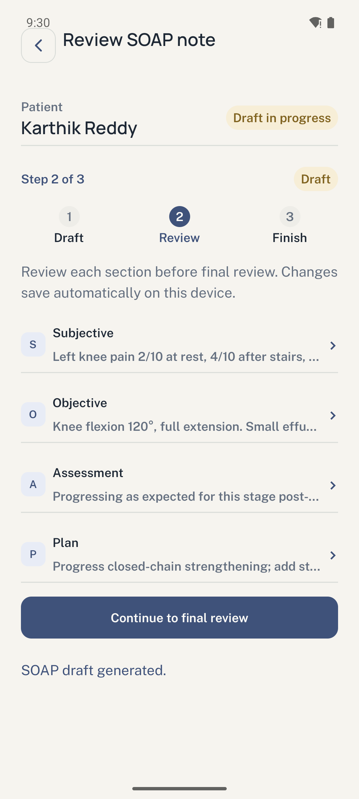 |
| Record the recap | Review and edit the transcript | SOAP draft, section by section |
| 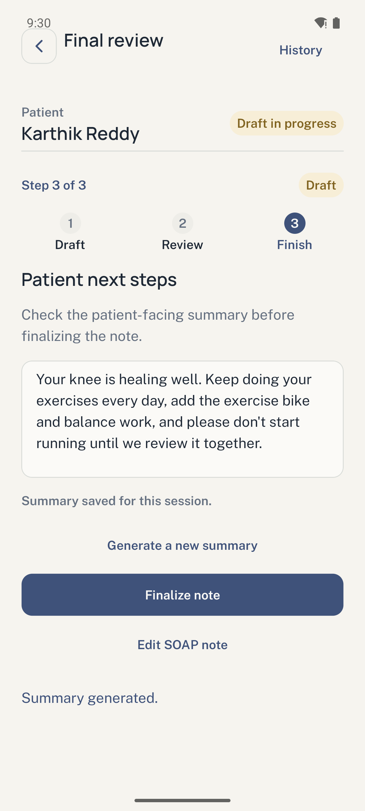 | 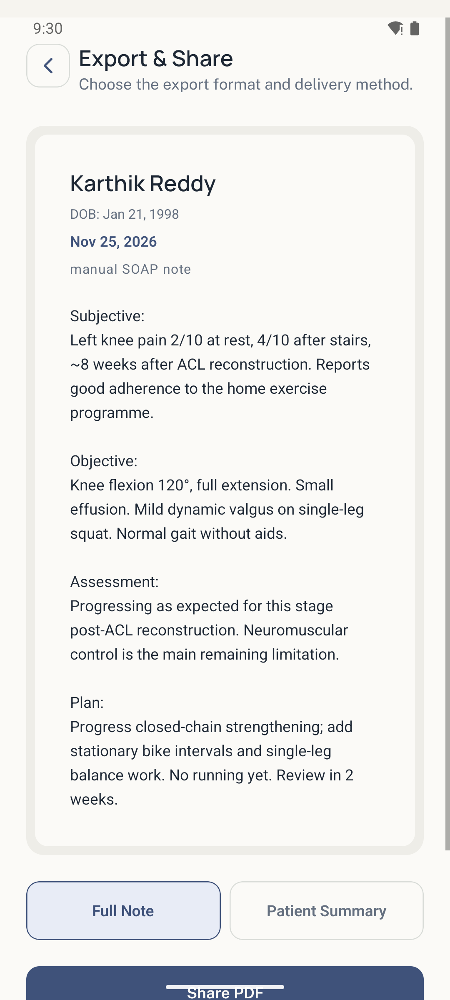 | 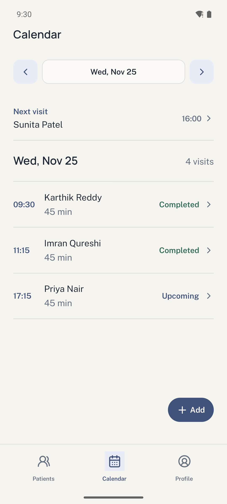 |
| Final review and patient summary | Export PDF or share the summary | Calendar and appointments |

All data shown is synthetic seed data.

## Engineering highlights

- **Consent-gated AI.** Audio upload, transcription and every AI draft check for an
  active patient consent record first
  ([`requirePatientAiConsent.ts`](backend/src/api/middleware/requirePatientAiConsent.ts)).
- **Staged, idempotent voice pipeline.** Upload → transcription → drafts as
  retryable stages. Inline in local mode, SQS plus a separate worker in the cloud,
  same code path ([`server.ts`](backend/src/server.ts),
  [`voiceWorker.ts`](backend/src/workers/voiceWorker.ts)).
- **Pluggable providers.** Sarvam STT and LLM in production, deterministic demo
  providers when no key is set, and model output validated with Zod before it's
  stored ([`providerRegistry.ts`](backend/src/domain/voice/providers/providerRegistry.ts)).
- **Refresh-token rotation with replay detection.** Reusing a rotated token revokes
  the user's sessions ([`routes/auth.ts`](backend/src/api/routes/auth.ts)).
- **Tenant isolation.** Every clinic id in a request must match the token
  ([`authorizeClinic.ts`](backend/src/api/middleware/authorizeClinic.ts)). Storage
  keys are normalized before the clinic prefix check, so encoded `..` can't cross
  clinics ([`s3Client.ts`](backend/src/infrastructure/s3/s3Client.ts)).
- **Storage abstraction.** S3 with presigned URLs in the cloud, the filesystem
  locally, behind one interface.
- **Encrypted offline queue.** Notes written without signal are kept in SecureStore
  and replayed on reconnect, with a capped dead-letter list
  ([`queueStore.ts`](mobile/features/offline/storage/queueStore.ts)).
- **Redacting logger.** Tokens, patient identifiers, clinical text and storage URLs
  are stripped before anything is logged
  ([`logger.ts`](backend/src/observability/logger.ts)).
- **About 920 tests, plus six device flows.** Vitest across all three workspaces,
  Maestro on an Android emulator, CI against a real Postgres
  ([testing](docs/testing.md)).

## Architecture

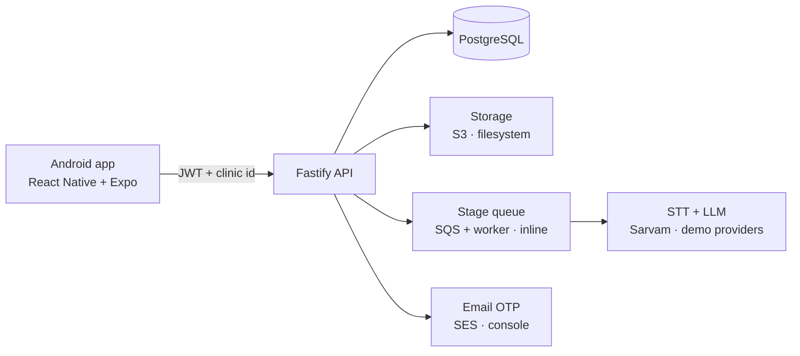

Local mode uses the right-hand option of each pair, so the whole system runs on a
laptop. In production it ran on AWS: EC2 behind Caddy, PostgreSQL, S3, SQS, SES,
SSM Parameter Store and CloudWatch, provisioned with Terraform. Details in
[docs/architecture.md](docs/architecture.md).

| Layer | Choice | Why |
| --- | --- | --- |
| Mobile | React Native, Expo SDK 55, TypeScript | One codebase, Android first, iOS later without a rewrite |
| State and forms | TanStack Query, React Hook Form, Zod | Server-state caching and retries; one schema for validation |
| API | Fastify 5 | Fast, typed, plugin model for auth and rate limits |
| Data | PostgreSQL 16, Prisma 7 | Relational clinical records with reviewed migrations |
| Contracts | Shared Zod schemas | API and app can't drift apart silently |
| Speech and drafting | Sarvam (Saaras STT, LLM) | Indian English and code-switched speech |
| Testing | Vitest, React Native Testing Library, Maestro | Fast unit/route tests plus real device flows |

## Run it

### Option A: API only, Docker (no Android needed)

```bash
docker compose up --build -d --wait
npm run api:tour        # needs curl and jq
```

This walks a full visit through the API: consent, voice upload, transcript, SOAP
draft, summary, finalize, PDF export, and a cross-clinic access attempt that gets
a 403. See [docs/api-tour.md](docs/api-tour.md).

### Option B: The full app on an Android emulator

Prerequisites: Node 22 (see `.nvmrc`), Docker, Android Studio with an emulator, and
JDK 17 or 21 for the Android build.

```bash
npm ci
npm run setup      # .env files from examples, Postgres in Docker, migrations, seed
npm run dev        # API on :3000
npm run android    # in a second terminal: build, install and start the app
```

Sign in as `clinician@example.com` / `password123`. The emulator reaches your
machine at `10.0.2.2:3000`, which `mobile/.env` already points at. For a USB phone,
run `adb reverse tcp:3000 tcp:3000` and set `EXPO_PUBLIC_API_BASE_URL=http://localhost:3000`.

**No keys needed.** With `SARVAM_API_KEY` empty, voice recaps use deterministic
demo providers, so any recording produces the same physio recap and note. Add a
[Sarvam](https://www.sarvam.ai) key to `backend/.env` to transcribe real speech.
Sign-up OTP codes are printed in the API console.

### Checks

```bash
npm run verify:local        # doctors, lint, typecheck, all test suites
npm run e2e:android:local   # Maestro device flows (app and API running)
```

## Docs

- [Architecture](docs/architecture.md): both runtimes, trust boundaries, the voice
  sequence
- Case studies: [voice pipeline](docs/case-studies/voice-pipeline.md),
  [clinical note safety](docs/case-studies/clinical-note-safety.md),
  [offline resilience](docs/case-studies/offline-resilience.md)
- [How it was built](docs/engineering-process.md): 14 phases and the review loop
- [Testing](docs/testing.md) · [API tour](docs/api-tour.md)
- [Design system](DESIGN.md) · [Product principles](PRODUCT.md)

## Roadmap and honest limits

- **Push reminders** have their data model and worker, but nothing schedules
  reminder rows yet.
- **Google Calendar push** is built and tested, but no caller enqueues pushes yet.
- **Voice and AI need a connection.** Manual notes work offline.
- **Not a certified medical-record system.** No regulatory certification is
  claimed. Use synthetic data only.
- The cloud deployment's Terraform isn't published here yet.

## License

Copyright © 2026 Murtaza Saifee. All rights reserved. You may clone, run and
evaluate this code for review purposes. It is not offered under an open-source
license. See [LICENSE](LICENSE).
