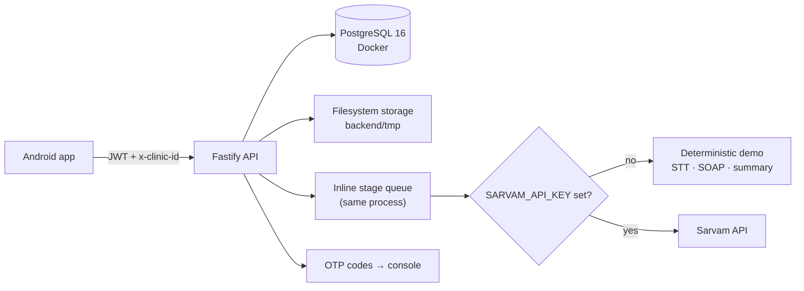
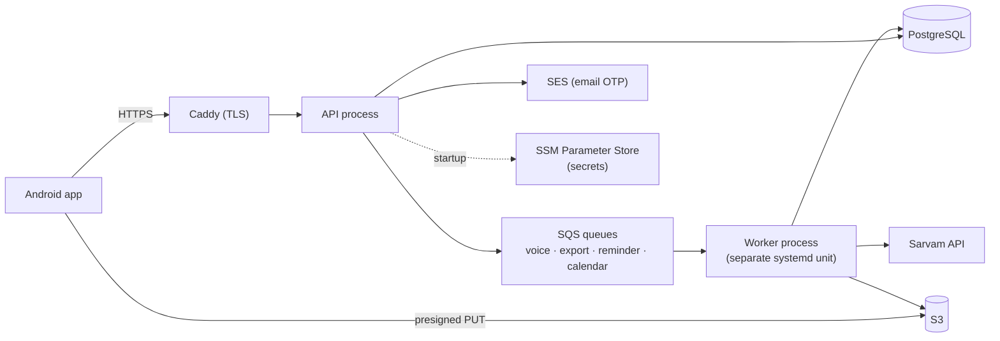
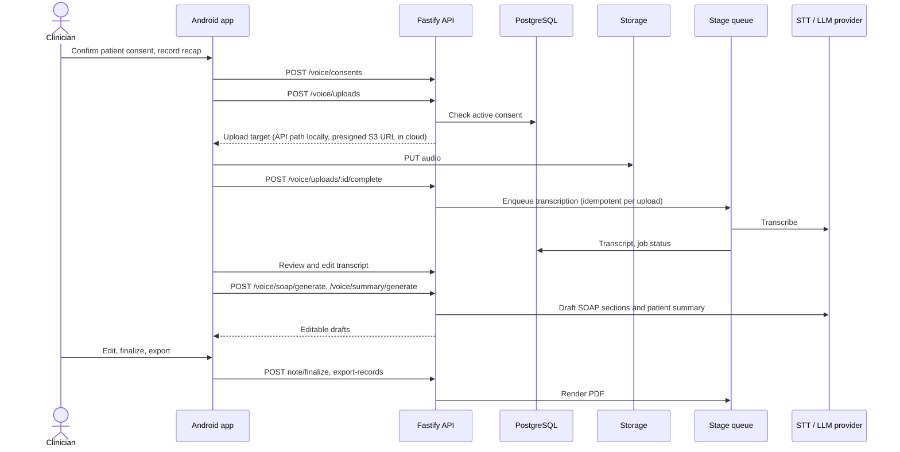

# Architecture

One codebase, two runtimes. `APP_ENV=local` runs everything on a laptop with no
cloud account and no API keys. `APP_ENV=staging|production` swaps the same
interfaces for AWS services. The domain code doesn't know which one it is on.

## Components

| Path | What it is |
| --- | --- |
| `mobile/` | React Native + Expo (SDK 55) Android app: TanStack Query, React Hook Form, Zod, Expo Audio, Expo SecureStore |
| `backend/src/api` | Fastify 5 routes, auth and clinic-scoping middleware, rate limits |
| `backend/src/domain` | Auth, patients, sessions, notes, voice pipeline, exports, audit, calendar |
| `backend/src/infrastructure` | Storage (S3 ↔ filesystem) and queue (SQS ↔ inline) adapters |
| `backend/src/workers` | Voice, export, reminder and calendar stage handlers |
| `backend/prisma` | PostgreSQL schema, migrations, synthetic seed |
| `shared/contracts` | Zod request/response contracts used by both app and API |

## Local runtime (`APP_ENV=local`)



## Cloud runtime (`APP_ENV=staging|production`)



`backend/src/server.ts` picks the adapters once, at startup:

```text
APP_ENV=local       → filesystem storage, inline stage queue, local voice providers, console OTP
APP_ENV=staging|prod → S3, SQS stage queues + worker, Sarvam providers, SES OTP, SSM secrets
```

Staging and production refuse to start unless `NODE_ENV` matches, HTTPS is
enforced and real secrets are present, so a misconfigured server can't fall back to
the local adapters.

## A voice recap, end to end



## Trust boundaries

- **Identity.** Access tokens are short-lived HS256 JWTs (algorithm pinned on
  verify). Refresh tokens rotate on every use and are stored hashed. Replaying a
  rotated refresh token revokes all of that user's sessions
  ([`routes/auth.ts`](../backend/src/api/routes/auth.ts),
  [`tokenService.ts`](../backend/src/domain/auth/tokenService.ts)).
- **Tenancy.** Every clinic id in params, query or body must equal the one in the
  token ([`authorizeClinic.ts`](../backend/src/api/middleware/authorizeClinic.ts)).
- **Storage.** Keys are normalized and resolved before the `clinics/<clinicId>/`
  prefix is checked, so encoded `..` segments can't cross clinics
  ([`s3Client.ts`](../backend/src/infrastructure/s3/s3Client.ts),
  [`routes/storage.ts`](../backend/src/api/routes/storage.ts)).
- **Consent.** Audio upload, transcription and every AI draft require an active
  patient AI-processing consent
  ([`requirePatientAiConsent.ts`](../backend/src/api/middleware/requirePatientAiConsent.ts)).
- **Errors and logs.** 5xx bodies are generic. The structured logger redacts
  passwords, tokens, patient identifiers, clinical text and storage URLs before
  anything is written
  ([`logger.ts`](../backend/src/observability/logger.ts)).
- **Device.** Refresh tokens, offline drafts and queued mutations live in Expo
  SecureStore. Android backup rules exclude them and exported documents.

## Offline behaviour

Manual note edits never block on the network. Drafts and queued mutations are
written to SecureStore (chunked, indexed before the payload is written so logout
can find partial writes) and replayed when connectivity returns
([`queueStore.ts`](../mobile/features/offline/storage/queueStore.ts),
[`syncService.ts`](../mobile/features/offline/services/syncService.ts)). Failed
mutations go to a capped dead-letter list that expires after 30 days. Voice and AI
features need a connection.
