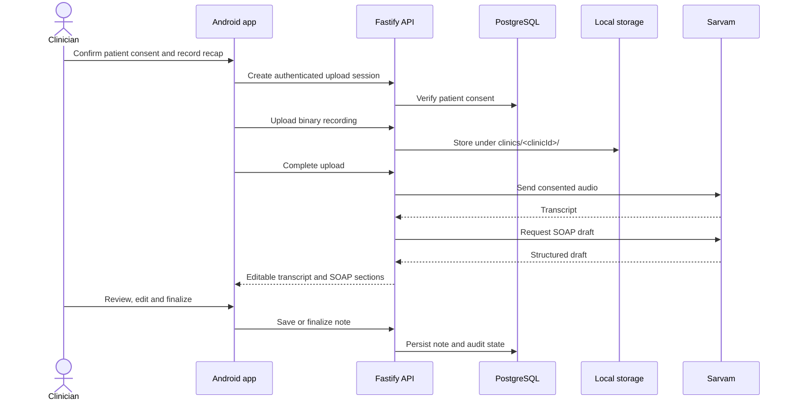

# Implemented architecture

## Components

- `mobile/`: React Native and Expo Android client using TanStack Query, React Hook Form, Zod, Expo Audio and Expo SecureStore.
- `backend/`: Fastify routes, domain services and Prisma repositories.
- `shared/`: TypeScript request, response and domain contracts shared by both applications.
- PostgreSQL 16: clinics, users, patients, appointments, sessions, notes, consent, audit and export metadata.
- Local storage: audio and generated files beneath `backend/tmp` or `LOCAL_STORAGE_DIR`.
- Sarvam: the only external API, used for speech-to-text and draft generation.

## Security boundaries

- Fastify authentication verifies access-token claims against the current user and token version.
- Clinic authorization prevents callers from supplying a different clinic identifier.
- Storage downloads require authentication, a matching `clinics/<clinicId>/` prefix and a path contained under the local storage root.
- Rotated refresh-token replay invalidates the active token family.
- Finalized notes reject ordinary edits but may be explicitly reopened through the supported audited workflow.
- AI routes check active patient consent before sending audio or text to Sarvam.

## Local resilience

Offline drafts and queued mutations are stored through Expo SecureStore. Draft identifiers are indexed before their clinical payload is written so logout cleanup can find partial writes. Dead-letter records are capped and expire from the readable queue after 30 days. Logout clears in-memory authentication first and then performs best-effort token and clinical-cache cleanup.

## Deliberate exclusions

The public showcase contains no cloud infrastructure, deployment workflow, remote queue, app-store submission profile or production runbook.
